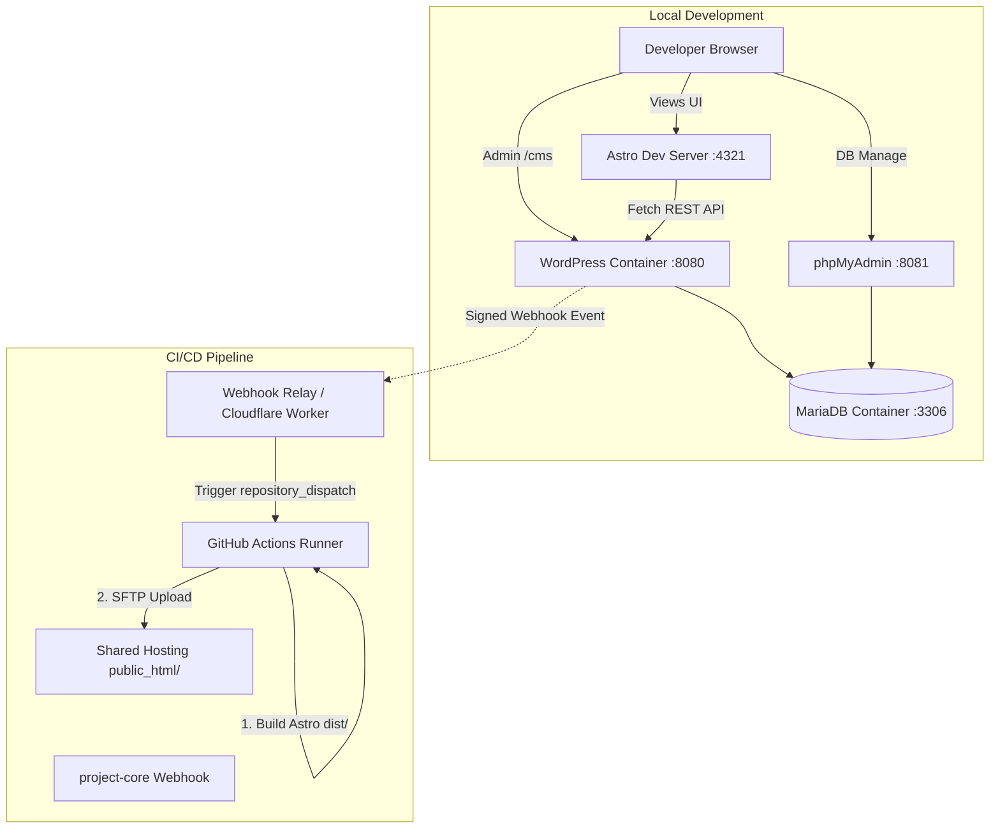
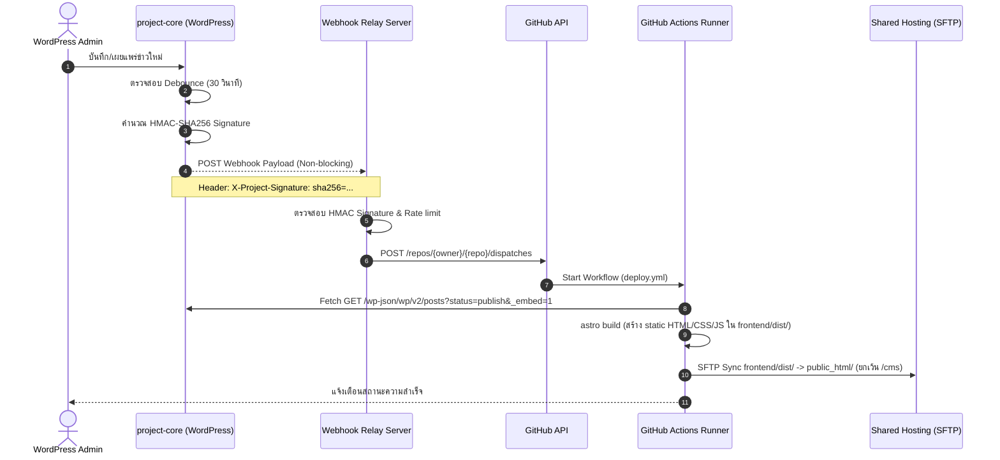

# DESIGN — System Architecture, Database & API Specifications

Version: 2.0  
Project: Technosrc Web (Astro + WordPress Headless Monorepo)  

---

## 1. System Architecture Overview



---

## 2. Database Schema & Storage Model

WordPress ใช้ตารางมาตรฐานของ MariaDB/MySQL ร่วมกับ Metadata ดังนี้:

### 2.1 Table: `wp_posts` & `wp_postmeta` (News & Articles)
- **`post_type = 'post'`**
  - `post_title`: หัวข้อข่าว
  - `post_name`: Slug ภาษาอังกฤษหรือไทย
  - `post_content`: เนื้อหาข่าวแบบ HTML
  - `post_excerpt`: ข้อความย่อ
  - `post_status`: `publish`, `draft`, `trash`
  - `post_date`: วันที่เผยแพร่ (`Asia/Bangkok`)
- **Metadata ใน `wp_postmeta`:**
  - `_thumbnail_id`: รหัส Attachment ID ของรูปปก (Desktop & Mobile)
  - `seo_meta_title`: หัวข้อ SEO สำหรับ Meta Tag (String)
  - `seo_meta_description`: คำอธิบายย่อสำหรับ Search Engine (String)
  - `seo_og_image_url`: ลิงก์รูปภาพ Open Graph เจาะจง (URL)

### 2.2 Table: `wp_posts` & `wp_postmeta` (Banners)
- **`post_type = 'banner'`**
  - `post_title`: ชื่อแบนเนอร์ (ใช้ระบุใน Admin)
  - `menu_order`: ลำดับการจัดเรียงจากน้อยไปมาก (Integer)
- **Metadata ใน `wp_postmeta`:**
  - `_thumbnail_id`: รูปภาพ Desktop
  - `banner_mobile_image_url`: URL รูปภาพเฉพาะมือถือ (URL)
  - `banner_target_url`: URL เมื่อคลิกแบนเนอร์ (URL)
  - `banner_is_active`: สถานะเปิดแสดงผล (`1` หรือ `0`)

### 2.3 Table: `wp_options` (Global Site Settings)
- **`option_name = 'project_core_site_settings'`** (JSON / Serialized Array):
```json
{
  "site_name": "TECHNOSRC",
  "site_tagline": "Digital Innovation & Cloud Architecture",
  "logo_url": "https://example.com/logo.svg",
  "favicon_url": "https://example.com/favicon.svg",
  "contact_email": "contact@technosrc.com",
  "contact_phone": "02-123-4567",
  "contact_address": "กรุงเทพมหานคร, ประเทศไทย",
  "office_hours": "จันทร์ - ศุกร์ 09:00 - 18:00 น.",
  "social_facebook": "https://facebook.com/technosrc",
  "social_line": "@technosrc",
  "social_linkedin": "https://linkedin.com/company/technosrc",
  "social_github": "https://github.com/technosrc",
  "footer_copyright": "© 2026 Technosrc. สงวนลิขสิทธิ์ทุกประการ.",
  "webhook_url": "https://relay.example.com/webhook",
  "webhook_secret": "******",
  "webhook_enabled": 1
}
```

---

## 3. REST API Specifications

### 3.1 Standard WP Posts API
- **Endpoint:** `GET /wp-json/wp/v2/posts`
- **Query Parameters:**
  - `status=publish`: ดึงเฉพาะบทความที่เผยแพร่แล้ว
  - `_embed=1`: รวมข้อมูล Featured Media และ Categories ใน Payload เดียว
  - `page`: หน้าที่ต้องการ (เริ่มต้น: 1)
  - `per_page`: จำนวนบทความต่อหน้า (สูงสุด: 100)
  - `orderby=date&order=desc`: เรียงจากใหม่ไปเก่า

### 3.2 Custom Endpoints (`project-core/v1`)

#### A. Health Check
- **Endpoint:** `GET /wp-json/project-core/v1/health`
- **Access:** Public
- **Response:**
```json
{
  "status": "ok",
  "timestamp": 1776333600,
  "datetime": "2026-10-16T09:00:00Z",
  "wp_version": "6.7.1",
  "headless": true
}
```

#### B. Public Site Settings
- **Endpoint:** `GET /wp-json/project-core/v1/site-settings`
- **Access:** Public (ซ่อน Webhook URL และ Secret)
- **Response:**
```json
{
  "site_name": "TECHNOSRC",
  "site_tagline": "Digital Innovation",
  "logo_url": "",
  "favicon_url": "/favicon.svg",
  "contact": {
    "email": "contact@technosrc.com",
    "phone": "02-123-4567",
    "address": "กรุงเทพมหานคร, ประเทศไทย",
    "office_hours": "จันทร์ - ศุกร์ 09:00 - 18:00 น."
  },
  "social": {
    "facebook": "",
    "line": "@technosrc",
    "linkedin": "",
    "github": ""
  },
  "footer_copyright": "© 2026 Technosrc. สงวนลิขสิทธิ์ทุกประการ."
}
```

#### C. Active Banners
- **Endpoint:** `GET /wp-json/project-core/v1/banners`
- **Query Parameters:** `position` (optional)
- **Response:**
```json
[
  {
    "id": 101,
    "title": "Modern Cloud Architecture",
    "desktop_image_url": "https://example.com/wp-content/uploads/banner1.jpg",
    "mobile_image_url": "https://example.com/wp-content/uploads/banner1-mob.jpg",
    "target_url": "/services/",
    "menu_order": 1
  }
]
```

---

## 4. Webhook & Automation Workflow



---

## 5. Security & Threat Mitigation

| ความเสี่ยง | มาตรการป้องกัน |
|---|---|
| **CMS Vulnerability** | หน้าเว็บสาธารณะเป็น Static HTML 100% ไม่มี PHP Engine หรือ MySQL Connection บนหน้าบ้าน |
| **Data Leakage** | Endpoint `/site-settings` ปิดกั้น Webhook URL และ Secret Key ไม่ส่งออกไปยัง Client |
| **Webhook Spoofing** | ทุก Webhook Request เข้ารหัสด้วย HMAC-SHA256 ผ่าน Shared Secret และตรวจสอบก่อนสั่ง GitHub Runner |
| **DDoS on Build System** | ระบบ Debounce (กักเวลา 30 วินาที) และ GitHub Concurrency Control ป้องกันการ Build ซ้ำซ้อน |
| **Deployment Accident** | สคริปต์ SFTP Sync จะไม่แตะต้องโฟลเดอร์ `/cms`, ฐานข้อมูล หรือไฟล์ `.htaccess` เดิม |
| **Secret Exposure** | ใช้ GitHub Repository Secrets และ `.gitignore` ป้องกันไม่ให้ Password หรือ Private Key ถูกบันทึกลง Git |
